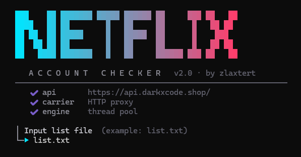
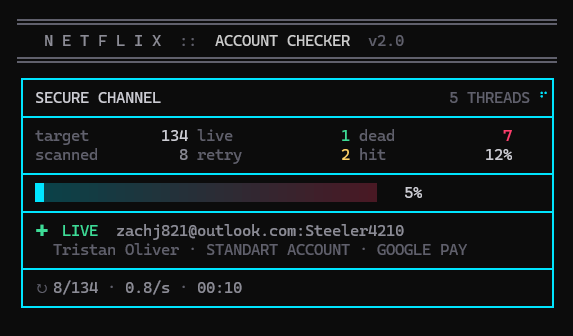
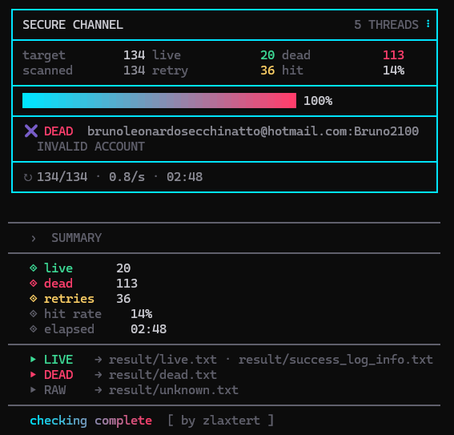

## NETFLIX-CHECKER-CLIV2.0

Netflix Account Security Tool v2.0 — CLI utility for security researchers to audit credential exposure using authorized API endpoints. Features multi-threading, proxy rotation, colored terminal UI, and structured result logging. Python 3.
<h1 align="center">
   
  
   
  NETFLIX CHECKER // NETFLIX VALIDATION
   
</h1>

  
  

 • <a href="https://t.me/zlaxtert">Contact</a> •
  <a href="https://darkxcode.site/">Other Tools</a> •

## Output

This is the result if the code is successfully validation.

---

> **NOTE**
> Warning All the information provided here is intended solely for educational and testing purposes.
> I do not endorse any illegal activities or unfair usage of this program.
